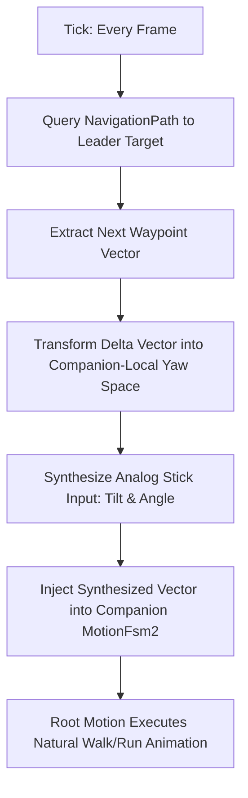

# 14-Day Production Implementation Plan: Leon & Claire Duo Gamemode (RE2 Remake)

This document specifies the complete 14-day production roadmap, technical architecture, low-level **RE Engine (`app.ropeway.*`, `via.*`)** reflection hooks, edge-case mitigation, and verification procedures for the single-player dual-protagonist overhaul mod for *Resident Evil 2 Remake* (2019).

```
┌────────────────────────────────────────────────────────────────────────────────────────┐
│                              PRODUCTION SPRINT TIMELINE                                │
├─────────────────────────┬─────────────────────────┬────────────────────────────────────┤
│ DAYS 1 – 4              │ DAYS 5 – 8              │ DAYS 9 – 14                        │
│ Engine Foundation,      │ Mechanics, Muzzle Rays, │ Audio C++ Bridge, Voice Pipeline,  │
│ Prefabs & Synthetic Nav │ Door Hooks & Combat AI  │ Scenario Serialization & QA Harness│
└─────────────────────────┴─────────────────────────┴────────────────────────────────────┘
```

---

## Technical Stack & Tooling

* **Hook Runtime:** [REFramework](https://github.com/praydog/REFramework) (by praydog) — native RE Engine reflection and Lua 5.4 scripting.
* **Audio Bridge:** Custom lightweight C++ plugin (`miniaudio_reframework.dll`) exposing native `.wav` streaming directly to Lua.
* **UI Layer:** REFramework embedded ImGui (docked cleanly to native inventory pause states).
* **Voice Pipeline:** Google Colab T4 GPU / Local CUDA running RVC v2 (Retrieval-based Voice Conversion).
* **QA & Verification:** In-engine automated scenario runner (`test_harness.lua`).
* **Packaging:** Fluffy Mod Manager 5000 compatible zip format.

---

## Sprint Schedule & Deep-Dive Implementations

### Phase 1: Engine Foundation, Prefabs & Synthetic Locomotion (Days 1–4)

#### Day 1: Asset & Weapon Preloading, Instantiation & Input Stripping
* **Engine Traps Handled:**
  * In Leon's scenario, Claire's `pl1000.pfb` is absent from active memory.
  * **The Weapon Prefab Trap:** If Claire attempts to equip or draw her weapon (`wp1000` SLS 60, `wp1200` GM 79) before those weapon prefabs are in memory, `app.ropeway.survivor.EquipmentManager` throws an uncaught `NullReferenceException` at frame $N+50$.
* **Tasks:**
  1. Hook `via.ResourceManager` to pre-cache survivor and weapon prefabs asynchronously before scene spawn:
     ```lua
     local preload_queue = {
         "natives/x64/objectroot/survivor/player/pl1000.pfb", -- Claire Body
         "natives/x64/objectroot/weapon/wp1000/wp1000.pfb",   -- SLS 60 Handgun
         "natives/x64/objectroot/weapon/wp1200/wp1200.pfb",   -- GM 79 Grenade Launcher
         "natives/x64/objectroot/weapon/wp1100/wp1100.pfb"    -- JMB Hp3
     }
     for _, path in ipairs(preload_queue) do
         via.ResourceManager.loadResource("prefab", path)
     end
     ```
  2. Instantiate companion entity at `LeaderPosition + Vector3(1.5, 0, -1.5)`.
  3. Strip `app.ropeway.survivor.PlayerInputReceiver` and `app.ropeway.survivor.PadManager` listeners from the companion to prevent hardware input mirroring.
  4. Force `app.ropeway.camera.CameraManager` to lock focus exclusively to the leader's `GameObject`.
* **Deliverable (Day 1):** Both characters spawn with loaded weapon models, without camera snapping or mirrored stick movements.

---

#### Day 2: Synthetic Analog Stick Locomotion (Root-Motion NavMesh)
* **Engine Traps Handled:**
  * Playable survivors lack enemy AI navigation drivers. They rely on root-motion driven by stick vectors in `via.motion.MotionFsm2`.
  * **Camera-Relative Stick Math Trap:** Feeding world-space angles directly into `MotionFsm2` causes the companion to spin in circles whenever the camera rotates. Input must be transformed relative to companion yaw.
* **Locomotion Pipeline:**



* **Tasks:**
  1. Instantiate an invisible `NavigationPath` query component anchored to the companion.
  2. Query path to destination: `TargetPos = LeaderPos - (LeaderForward * 1.5)`.
  3. Transform delta vector into companion-local yaw:
     ```lua
     local dx = target_wp.x - comp_pos.x
     local dz = target_wp.z - comp_pos.z
     local world_angle = math.atan(dx, dz)
     local comp_euler = comp_transform:call("get_EulerAngles")
     local local_angle = world_angle - comp_euler.y
     local stick_x = math.sin(local_angle)
     local stick_y = math.cos(local_angle)
     ```
  4. Scale stick magnitude based on distance: $> 3.5\text{m} \implies \text{Run (1.0)}$; $< 3.5\text{m} \implies \text{Walk (0.5)}$; $< 1.2\text{m} \implies \text{Idle (0.0)}$.
* **Deliverable (Day 2):** Companion moves smoothly along RPD corridors using native root-motion animations without turning donuts during camera pans.

---

#### Day 3: Portal Culling Defense & Elevator Kinematic Parenting
* **Engine Traps Handled:**
  * RE2 unloads room collision meshes immediately upon door closure.
  * **Elevator Kinematic Clipping Trap:** Kinematic platforms (NEST lift, Chief Irons' elevator) move on a fixed timeline. Frame-rate independent synthetic stick inputs cause Y-axis desync, dropping the companion through the platform floor.
* **Tasks:**
  1. **Room Portal Defense:**
     * Hook `app.ropeway.GimmickDoor:onClose()`.
     * If `LeaderRoomID ~= CompRoomID`, instantly snap companion 2m behind leader.
  2. **Elevator Kinematic Parenting:**
     * Detect when leader enters an active elevator volume (`app.ropeway.ElevatorZone`).
     * Temporarily disable companion capsule collision and parent companion `Transform` to the elevator platform transform:
       ```lua
       function on_elevator_enter(elevator_gameobject)
           companion_collider:set_Enabled(false)
           companion:get_Transform():set_Parent(elevator_gameobject:get_Transform())
       end
       function on_elevator_exit()
           companion:get_Transform():set_Parent(nil)
           companion_collider:set_Enabled(true)
       end
       ```
* **Deliverable (Day 3):** Clean transitions through closing doors and zero floor-clipping on moving vertical platforms.

---

#### Day 4: Companion Command FSM & ImGui Command Wheel
* **Tasks:**
  1. Build the Finite State Machine in `fsm.lua`:
     * `STATE_FOLLOW`: Active synthetic stick navigation along NavMesh waypoints.
     * `STATE_WAIT`: Feed zero stick tilt, enter low-profile scan stance.
     * `STATE_COVER`: Proximity tethered to 1.5m, orienting toward nearest threat.
  2. Implement the **Tactical Command Wheel** via ImGui:
     * Bound to `Middle Click` or `RB / R1`.
     * Slow down world timescale (`app.ropeway.TimeManager:setTimeScale(0.4)`) while active.
  3. Wire native voice audio triggers for command confirmations.
* **Deliverable (Day 4):** Responsive radial menu allowing tactical state toggles on the fly.

---

### Phase 2: Mechanics, Muzzle Rays, Door Hooks & Combat AI (Days 5–8)

#### Day 5: Cutscene De-Tagging & Safe 1-Frame Door Spoofing State Machine
* **Engine Traps Handled:**
  * Cutscene timelines bind tracks by searching for survivor tags; companions can hijack timeline tracks.
  * **The `hasItem()` UI Desync Trap:** If the player opens their inventory menu in the exact frame the companion uses a key, swapping keys in inventory slot 1 will cause HUD/menu flicker or item mismatch errors.
* **Tasks:**
  1. **Cutscene Protection:** Strip `SurvivorTag` and disable `via.render.Mesh` on `onCutsceneStart()`; restore on `onCutsceneEnd()`.
  2. **Safe Door Interaction State Machine:**
     ```lua
     local door_interaction = {
         in_progress = false,
         slot1_backup = nil
     }
     
     -- Hook: Door interaction trigger
     function on_door_interact(door, leader_inv, comp_inv, required_key)
         if not leader_inv:hasItem(required_key) and comp_inv:hasItem(required_key) then
             -- Safety check: ensure player pause inventory is closed
             if not app.ropeway.survivor.InventoryMenu:isOpen() then
                 door_interaction.in_progress = true
                 door_interaction.slot1_backup = leader_inv:getItem(1)
                 leader_inv:setItem(1, required_key)
                 
                 -- Play companion step-up & voice line
                 play_voice("claire_door_unlock_01.wav")
                 trigger_companion_reach_pose()
                 
                 -- Restore on next frame
                 re.run_frame_delay(1, function()
                     leader_inv:setItem(1, door_interaction.slot1_backup)
                     door_interaction.in_progress = false
                 end)
             end
         end
     end
     ```
* **Deliverable (Day 5):** Cutscenes run cleanly; companion unlocks character-specific doors safely without UI corruption or permanent map marking bugs.

---

#### Day 6: ImGui Dual-Bag Docking & Contextual Offloading
* **Tasks:**
  1. Maintain companion 8-slot inventory array in Lua.
  2. **"Hold This" Offload Hook:**
     * Intercept `InventoryManager:canAddItem()`.
     * If leader bag is full and companion bag has room:
       * Display in-world prompt: `[E] Ask Claire to hold this`.
       * On press: Transfer world item directly to companion bag, despawn world object, play offload banter.
  3. **ImGui Dual-Bag Docking:**
     * Dock ImGui inventory window beside native pause inventory.
     * Provide `[Pass to Partner]` and `[Take from Partner]` actions.
* **Deliverable (Day 6):** Fluid dual-inventory management without editing fragile binary `.gui` assets.

---

#### Day 7: Muzzle Raycast Layer Masking & Licker Acoustic Stealth
* **Engine Traps Handled:**
  * `WeaponGun` raycasts from active screen camera center.
  * **Raycast Self-Collision Trap:** Firing companion bullets from the muzzle can register collisions with the leader's back collider if the leader stands in the companion's field of fire.
  * **Licker Acoustic Sprint Trap:** If the companion sprints near a Licker, the Licker immediately aggros.
* **Tasks:**
  1. **Muzzle Bone Raycast with Layer Filtering:**
     * Hook `app.ropeway.weapon.WeaponGun:fireBullet()`.
     * Override raycast origin with `snd_muzzle` joint position.
     * Configure raycast mask to exclude `Survivor` and `Player` collision layers:
       ```lua
       local layer_mask = CollisionSystem.get_LayerMask("Enemy") | CollisionSystem.get_LayerMask("Door")
       Physics.raycast(muzzle_pos, target_dir, max_dist, layer_mask)
       ```
  2. **Specialized Weapon Handlers:**
     * Detect beam weapons (Spark Shot / Linear Launcher) where muzzle point is absent; anchor raycast to `snd_r_hand` joint.
  3. **Licker Acoustic Speed Clamping:**
     * Scan active room for `em0020` (Licker).
     * If Licker is unalerted in room, hard-clamp companion stick magnitude to $\le 0.5$ (Walk only) regardless of distance to leader.
  4. **Ammo Depletion:** Decrement inventory ammo; fire *"I'm out!"* line and retreat to cover when count = 0.
* **Deliverable (Day 7):** Companion fires accurately from their weapon muzzle without back-shooting the leader, and sneaks silently around Lickers.

---

#### Day 8: Anti-Grab Hitbox Filtering & Downed/Revive System
* **Engine Traps Handled:**
  * Synchronized zombie grab animations violently hijack camera focus.
  * RE2 lacks native downed/incapacitation animations for survivors.
* **Tasks:**
  1. **Anti-Grab Hitbox Hook:**
     * Intercept `app.ropeway.enemy.AttackPermitManager:requestAttack()`.
     * Cancel synchronized grab attempts targeting companion; convert hits into standard bite/chip damage with stagger.
  2. **Downed State via Motion Hijacking:**
     * When companion HP reaches 0:
       * Force `MotionFsm2` into `damage_crawl_loop` or `stumble_kneel`.
       * Freeze normalized animation time to prevent automatic standing.
       * Display 45-second **Bleed-Out Timer** on HUD.
       * Revive via `[E]` using Green Herb (35% HP) or First Aid Spray (100% HP).
       * Trigger Game Over if timer reaches 0.
* **Deliverable (Day 8):** Stable combat against enemies with a working incapacitation and revive loop.

---

### Phase 3: Audio C++ Bridge, Voice Pipeline, Scenario Serialization & QA (Days 9–14)

#### Day 9: Custom C++ Audio Plugin Bridge (`miniaudio_reframework.dll`)
* **Engine Traps Handled:**
  * REFramework Lua lacks a `.wav` audio engine; Wwise `.pck` bank repacking is prohibitive.
  * **Audio Lifecycle Trap:** External audio threads continue playing over pause menus, death screens, or Alt+Tab unless explicitly hooked.
* **Tasks:**
  1. Compile lightweight C++ plugin using [miniaudio](https://miniaud.io/):
     ```cpp
     EXPORT bool play_wav(const char* filepath, float volume, float pan);
     EXPORT void pause_all_audio();
     EXPORT void resume_all_audio();
     EXPORT void stop_all_audio();
     ```
  2. Hook engine lifecycle events in Lua:
     * Hook `via.hid.GamePad:onFocusLost()` and `onPause()` $\implies$ `Audio.pause_all()`.
     * Hook `onFocusGained()` and `onResume()` $\implies$ `Audio.resume_all()`.
     * Hook `app.ropeway.GameOverManager:onGameOver()` $\implies$ `Audio.stop_all()`.
* **Deliverable (Day 9):** External `.wav` files stream cleanly with proper pause, focus-loss, and death handling.

---

#### Day 10: Dynamic Banter Engine & Situational Triggers
* **Tasks:**
  1. Create `banter_manager.lua` to manage voice queue and line priority.
  2. Implement Contextual Triggers:
     * `Trigger_SafeRoom`: Fires after 5 seconds in safe room without combat (whisper dialogue).
     * `Trigger_DangerHP`: Fires when leader or companion HP drops into Danger state.
     * `Trigger_CombatAftermath`: Fires after clearing room of $\ge 3$ zombies or 1 Licker.
     * `Trigger_Radio`: Simulates walkie-talkie audio during separated sequences.
* **Deliverable (Day 10):** Natural conversational banter engine responding dynamically to gameplay context.

---

#### Day 11: Voice Scripting & GPU Cloud RVC Batch Conversion
* **Tasks:**
  1. Finalize the 4-Act dialogue script (~120 lines covering banter, safe room intimacy, panic, and ammo callouts).
  2. Record clean vocal takes on a standard microphone with accurate emotional pacing (soft safe room whispers, combat yelling).
  3. Set up **RVC v2 WebUI** on Google Colab (T4 GPU) or local CUDA with trained models for:
     * Nick Apostolides (Leon)
     * Stephanie Panisello (Claire)
  4. Batch convert audio files, export 48kHz `.wav` clips, and structure them into `reframework/data/duo_mode/audio/`.
* **Deliverable (Day 11):** Complete, studio-quality custom voice library integrated and mapped to the banter engine.

---

#### Day 12: Courtyard Gate Integration & Radio Separation Sequences
* **Tasks:**
  1. **Courtyard Breach Trigger:**
     * Hook back gate interaction; cutting chain unlocks gate and triggers dual entry sequence.
  2. **Parking Garage / Orphanage Radio Separation:**
     * Script separation at Parking Garage shutter: Claire pursues Sherry / Chief Irons, Leon searches for Ben's cell keycard.
     * Hook radio dialogue triggers during solo segments so characters stay in contact over walkie-talkie.
  3. **Sewers Monitoring Room Reunion:**
     * Script reunion in Central Monitoring Room with wounded partners (Ada and Sherry) resting on couches.
* **Deliverable (Day 12):** Coherent narrative flow bridging initial meeting, separation, and emotional sewers reunion.

---

#### Day 13: ScenarioManager Serialization & Multi-Slot Save Persistence
* **Engine Traps Handled:**
  * Super Tyrant (Leon) and G-Phase 4 (Claire) belong to mutually exclusive scenario IDs (`ScenarioManager`).
  * **Save Slot Desync Trap:** Saving in Slot 1, playing 30 minutes, saving in Slot 2, and reloading Slot 1 will corrupt companion inventory unless saved states are strictly indexed per native save slot.
* **Tasks:**
  1. **Multi-Slot Save Persistence:**
     ```lua
     function get_save_path(slot_id)
         if slot_id == 99 then 
             return "reframework/data/duo_mode/save_state_scenario_transition.json" 
         end
         return string.format("reframework/data/duo_mode/save_state_slot_%02d.json", slot_id)
     end
     
     -- Hook native save/load functions
     function on_native_save(slot_id)
         serialize_companion_state(get_save_path(slot_id))
     end
     function on_native_load(slot_id)
         deserialize_companion_state(get_save_path(slot_id))
     end
     ```
  2. **Cross-Campaign Boss Climax Transition:**
     * On Super Tyrant defeat on elevator:
       1. Serialize live state to transition JSON (`slot_id = 99`).
       2. Call `app.ropeway.ScenarioManager:setScenario()` to Claire's final stage index.
       3. Trigger native level load for Train Turntable.
       4. Upon stage init: re-inject inventories and spawn both characters facing G-Phase 4.
* **Deliverable (Day 13):** Clean multi-slot save persistence and seamless cross-campaign dual boss climax.

---

#### Day 14: Automated QA Test Harness (`test_harness.lua`) & Packaging
* **Tasks:**
  1. Build `test_harness.lua` with console commands:
     ```lua
     -- Commands:
     -- duo_test_licker()     -> Teleports to West Corridor, spawns Licker, verifies speed clamp
     -- duo_test_elevator()   -> Teleports to NEST lift, activates movement, checks Y-clipping
     -- duo_test_door_lock()  -> Teleports to Heart Door, tests 1-frame spoof without inventory UI
     -- duo_test_boss_jump()  -> Simulates Super Tyrant kill and asserts G4 stage transition
     ```
  2. Run the automated suite to verify all critical edge cases log `PASS`.
  3. Package the mod for **Fluffy Mod Manager**:
     * Structure: `modinfo.ini`, `natives/`, `reframework/autorun/`, `reframework/plugins/miniaudio_reframework.dll`.
* **Deliverable (Day 14):** Production-ready release build verified by automated test harness and packaged into a clean drag-and-drop zip archive.

---

## Technical Risk Mitigation Matrix

| Problem Identified | Root Cause | Implemented Solution |
| :--- | :--- | :--- |
| **Weapon NullReferenceCrash** | Companion draws weapon prefabs not preloaded in RAM | Preload `pl1000`, `wp1000`, `wp1200`, `wp1100` asynchronously on Day 1. |
| **Donut Spinning on Camera Pan** | World-space stick angles fed into root-motion controller | Transform target waypoint vector into companion-local yaw coordinates. |
| **Elevator Floor Clipping** | Kinematic platform movement desyncs with frame polling | Temporarily disable collider and parent companion `Transform` to elevator. |
| **Door 1-Frame Inventory Flicker** | Native door UI reads Slot 1 while player menu is open | Implement `door_interaction` state machine with slot 1 backup and safety check. |
| **Muzzle Raycast Leader Hit** | Companion shoots leader standing in line of fire | Exclude `Survivor` and `Player` collision layers in raycast mask. |
| **Licker Acoustic Aggro** | Companion sprints near acoustic enemy | Proximity scanner clamps companion stick magnitude to $\le 0.5$ (Walk only). |
| **Audio Playing Over Menus** | External miniaudio thread unlinked from game lifecycle | Hook `onFocusLost`, `onPause`, and `onGameOver` to pause/stop audio bridge. |
| **Save File Desync Across Slots** | Single global JSON overwrites on every save | Dynamically index save files per native slot: `save_state_slot_%02d.json`. |
| **Cross-Campaign Boss Loading** | Super Tyrant & G4 belong to mutually exclusive scenarios | Serialize state to JSON, programmatically flip scenario index, and re-inject state. |
| **Playtesting Fatigue** | Replaying full scenarios 30+ times to catch edge cases | In-engine automated test harness (`test_harness.lua`) running isolated test suites. |
