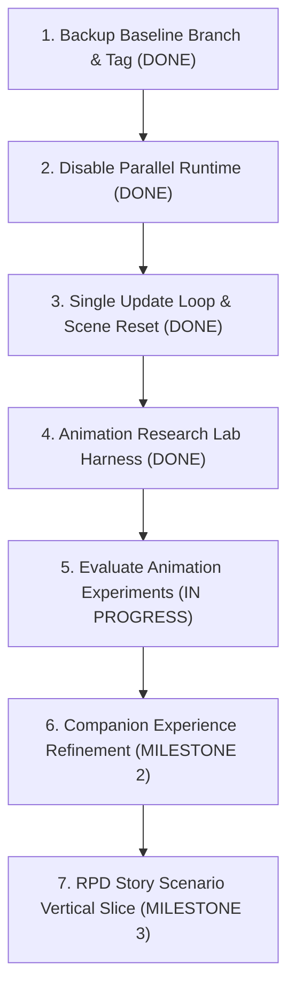

# RE2 Duo Mode — Project Reset & Milestone Execution Report

**Date:** November 9, 2026  
**Repository:** [AryanTechie-007/RE2NewMode](https://github.com/AryanTechie-007/RE2NewMode) (Branch: `main`)  
**Sandbox:** `D:\Games\RE2_DuoMode_Sandbox`  
**Baseline Tag:** [`v0.1-baseline`](file:///D:/Gamesregarding)  
**Legacy Baseline Branch:** `legacy/working-baseline`  

---

## 1. Executive Summary & Philosophy Shift

The project has undergone a complete technical consolidation in accordance with the **Honest Project Assessment & Implementation Roadmap**:
* **From:** An aspirational 14-day waterfall schedule with 70% stub modules and duplicate frame loops.
* **To:** A grounded reverse-engineering roadmap prioritizing a story-driven single-player duo experience for Leon and Claire.

### The Three Cardinal Rules (Enforced)
1. **Rule 1 — No Imaginary Functionality:** All features are classified into four transparent categories: `Implemented and tested in-game`, `Partially implemented`, `Experimental`, and `Planned`.
2. **Rule 2 — No Speculative RE Engine APIs in Production:** Unverified engine reflection methods are isolated inside sandboxed diagnostic tools.
3. **Rule 3 — Always Maintain a Playable Build:** Every commit preserves working companion spawning, follow gliding, and tactical orders.

---

## 2. Immediate Execution Checklist Progress



| # | Task | Status | Output / Deliverable |
| :--- | :--- | :---: | :--- |
| **1** | **Backup Repository** | ✅ **COMPLETE** | Created permanent branch `legacy/working-baseline` and tag `v0.1-baseline`. |
| **2** | **Disable Parallel Runtime** | ✅ **COMPLETE** | Moved `duo_mode.lua` and the 13 stub modules to `archive/experimental_modules/` in both repo and sandbox. |
| **3** | **Authoritative Runtime** | ✅ **COMPLETE** | `character_renderer.lua` consolidated with a single authoritative `re.on_frame` loop and scene-unload cleanup. |
| **4** | **Animation Test Harness** | ✅ **COMPLETE** | Built `animation_lab.lua` with isolated runners for Experiments A, B, and C + live ImGui UI. |
| **5** | **Choose Animation Pathway** | 🟡 **IN PROGRESS** | Ready for in-game testing via `animation_lab.lua`. |
| **6** | **Companion Refactoring** | ⏳ **PENDING** | Scheduled for Milestone 2 after animation spike resolution. |
| **7** | **RPD Story Scenario** | ⏳ **PENDING** | Scheduled for Milestone 3 (Courtyard $\to$ Main Hall $\to$ Safe Room vertical slice). |

---

## 3. Structural Consolidation Summary

### Authoritative Runtime
* [`character_renderer.lua`](file:///D:/Gamesregarding/reframework/autorun/character_renderer.lua):
  - Retains all proven, battle-tested features: Claire 3D mesh spawning (Body + Head + Hair), smooth glide locomotion, room portal snaps, elevator kinematic parenting, cutscene mesh hiding, rubber-band catch-up, and the 3-state radial tactical wheel (`FOLLOW`, `WAIT`, `COVER`).
  - **Single Update Loop:** Eliminated duplicate `re.on_frame` registrations. All frame logic, streaming, locomotion, and UI windows run in a single master loop with error isolation.
  - **Scene Transition Guard:** Detects `cur_scene` changes between levels/saves and triggers clean entity despawning to prevent ghost actors.

### Archived Modules
The parallel modules from the earlier 14-day schedule have been safely relocated to [`archive/experimental_modules/`](file:///D:/Gamesregarding/archive/experimental_modules/):
* `duo_mode.lua`
* `spawner.lua`, `locomotion.lua`, `combat_ai.lua`, `door_hooks.lua`, `health_manager.lua`, `inventory_manager.lua`, `audio_bridge.lua`, `banter_manager.lua`, `save_manager.lua`, `test_harness.lua`, etc.
* Zero lines of code were lost; everything is archived for gradual migration when real engine hooks are verified.

---

## 4. Milestone 1: Animation Research Lab (`animation_lab.lua`)

To break through the animation technical blocker without crashing the main companion controller, [`animation_lab.lua`](file:///D:/Gamesregarding/reframework/autorun/animation_lab.lua) has been built and deployed:

### Experiment Matrix & Acceptance Criteria

```
┌────────────────────────────────────────────────────────────────────────┐
│                        MILESTONE 1 ANIMATION SPIKE                     │
├─────────────────────────┬──────────────────────┬───────────────────────┤
│ Experiment              │ Target Subsystem     │ Concrete Evidence     │
├─────────────────────────┼──────────────────────┼───────────────────────┤
│ Exp A: Native NPC Cast  │ SurvivorAssignManager│ Valid entity returned │
│                         │ StandbyCatalog       │ with Motion & FSM2    │
├─────────────────────────┼──────────────────────┼───────────────────────┤
│ Exp B: Duplication      │ duplicateGameObject  │ Surviving components, │
│                         │ Input Stripping      │ independent transform │
├─────────────────────────┼──────────────────────┼───────────────────────┤
│ Exp C: Motion Bank      │ MotionBankAsset      │ TreeLayer playback    │
│                         │ TreeLayer            │ without C++ exception │
└─────────────────────────┴──────────────────────┴───────────────────────┘
```

### In-Engine Testing Instructions
1. Launch `Resident Evil 2.exe` from `D:\Games\RE2_DuoMode_Sandbox\`.
2. Load any active Leon gameplay save (e.g. RPD Main Hall or Courtyard).
3. Press **Insert** to display the REFramework menu.
4. Under **Script Generated UI**, toggle **"Open Animation Research Lab Window"**.
5. Test the experiments:
   - **Tab 2 (Exp A):** Click `[Run Experiment A Probe]` to inspect Capcom's `SurvivorAssignManager` and candidate casting signatures.
   - **Tab 3 (Exp B):** Click `[Spawn Duplicate Actor]` to test `via.Scene.duplicateGameObject`, verify input stripping, and observe surviving blend tree components. Click `[Destroy Test Clone]` when finished.
   - **Tab 4 (Exp C):** Click `[Probe Leon Motion & Layers]` to read Leon's active motion bank asset and verify layer parameters.
   - **Tab 5 (Logs):** Review live diagnostics logged to `reframework/data/duo_mode/animation_lab_log.txt`.

---

## 5. Upcoming Milestones

* **Milestone 2 (Companion Experience):**
  - Smooth trailing distances, hallway collision avoidance, and threat-facing reactions.
* **Milestone 3 (Story Engine & Vertical Slice):**
  - Scenario scripting for the Courtyard reunion sequence, RPD entrance, and Safe Room contextual conversation.
* **Milestone 4 (Doors, Combat & Survival):**
  - Verified door interaction hooks, defensive fire reactions, and downed/revive logic.
